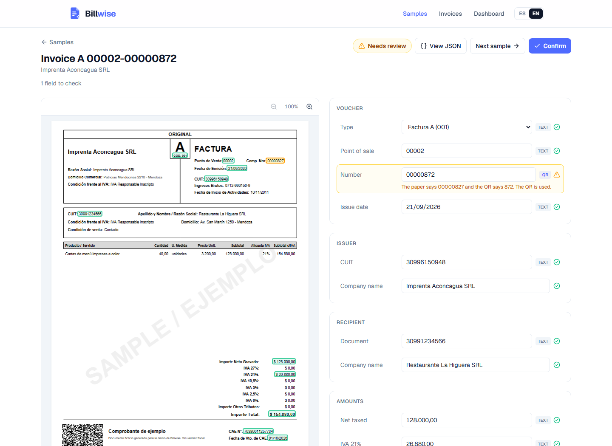
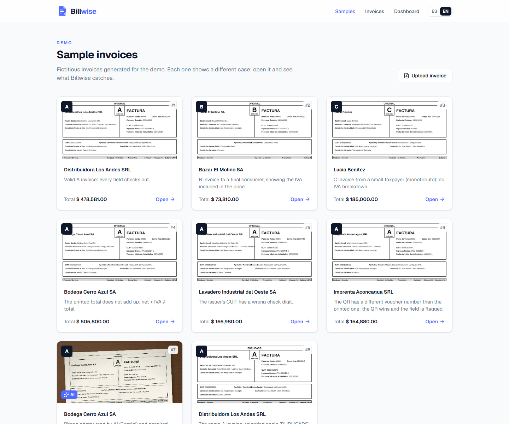
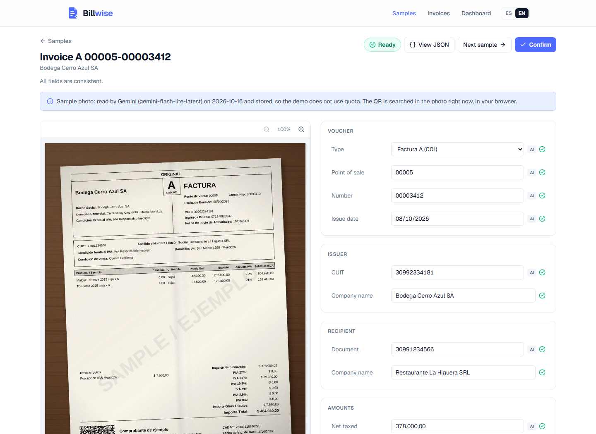
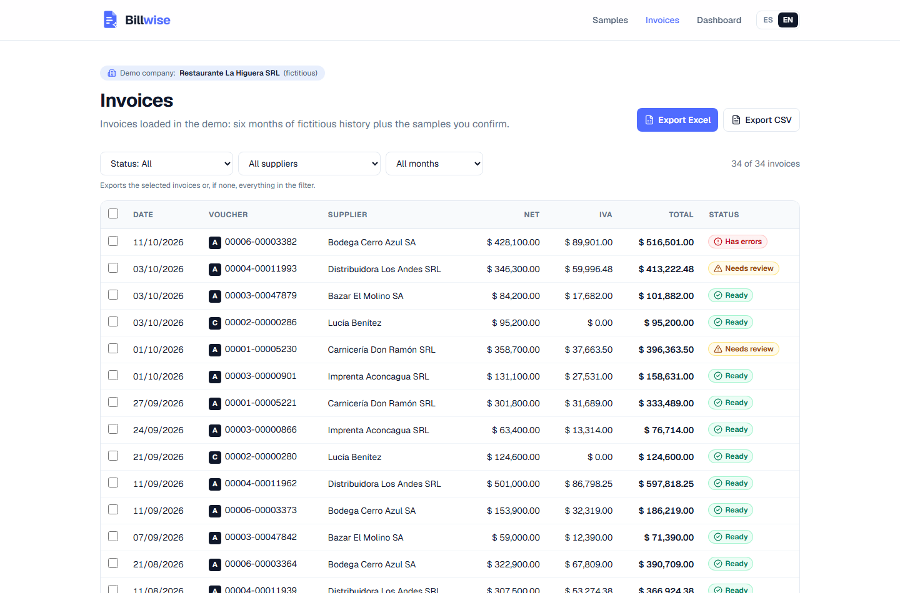
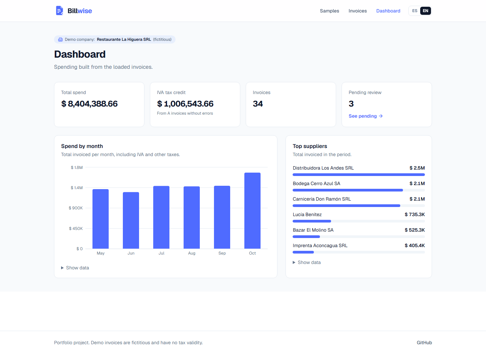
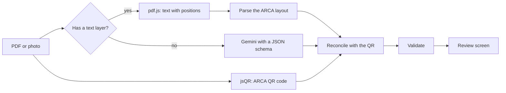

# Billwise

**Smarter invoice processing.**

AI-powered extraction and validation of Argentine invoices.

Billwise turns Argentine electronic invoices into structured, validated data. It combines ARCA QR decoding, PDF text extraction and AI-powered reading for scanned documents, with tax-specific validation rules and a review interface that links extracted values back to their source.

Built with TypeScript, Next.js and Gemini, Billwise explores a hybrid approach to document processing: deterministic extraction wherever possible, AI when necessary, and explicit validation before data is confirmed.

**Live demo:** [billwise-mjv.vercel.app](https://billwise-mjv.vercel.app) · Spanish by default, English with the switch in the header.



## What it does

- **Reads PDFs in the browser.** pdf.js extracts the text with its position on the page and the ARCA QR is decoded from the rendered page. The file never leaves the device.
- **Trusts the QR over the paper.** The QR is the authorized record. When the printed text disagrees with it, the QR wins and the field is flagged.
- **Validates like an accountant would.** CUIT check digit, totals, IVA per rate, letter rules (A, B, C), formats, dates and duplicates.
- **Uses AI only where it is needed.** Photos and scanned PDFs are sent to Gemini with a JSON schema, after asking the visitor for permission. The answer goes through the same validation and QR cross-check.
- **Lets you review and fix.** Click a highlight to jump to its field, edit any value, confirm the invoice.
- **Exports and summarizes.** Invoice list with filters, export to Excel and CSV, and a spending dashboard.

| Sample invoices                                                                      | Photo read by AI                                                                                    |
| ------------------------------------------------------------------------------------ | --------------------------------------------------------------------------------------------------- |
|  |  |
| **Invoice list and export**                                                          | **Dashboard**                                                                                       |
|                |                   |

## How it works



1. **Read.** For PDFs, `packages/reader` extracts every text item with its box on the page, ignoring rotated text such as watermarks, and renders the page to look for the QR.
2. **Parse.** `packages/shared` turns the "Label: value" layout of ARCA invoices into an invoice model and keeps where each value was found.
3. **Reconcile.** The QR payload (base64 JSON with date, CUIT, point of sale, voucher type and number, total, currency and CAE) fills missing fields and overrides wrong ones.
4. **Validate.** Every rule returns a code, a severity and parameters. The UI turns codes into messages in each language.
5. **Fall back to AI.** If there is no text layer, the visitor can send the file to Gemini. The model answer is mapped field by field and anything malformed is dropped instead of trusted.

## Technical decisions

- **The QR beats both the text and the AI.** It is the data ARCA authorized, so any disagreement is resolved in its favor and shown to the user.
- **The AI returns values, not coordinates.** Language models are unreliable at locating text boxes. For PDFs, positions come from pdf.js, which is exact.
- **Text first, AI second.** Most electronic invoices are digital PDFs that can be read for free, offline and in milliseconds. The AI is only offered for photos and scans.
- **Shared logic.** Parsing and validation live in `packages/shared` as pure functions, used by the browser, the command line reader and the tests.
- **Zero cost by design.** The demo runs on Vercel's free plan and Gemini's free tier, with billing disabled on the Google project. Each visitor gets two AI readings per day, tracked in a signed cookie, and the API key never reaches the browser. If the daily quota runs out, the demo says so and points to the samples.
- **A stored AI reading for the demo.** The sample photo was read by Gemini once and its answer is stored in the repo, so visitors see the AI path without spending quota. A test fails if the stored answer no longer matches the invoice.
- **Test data generated by the repo.** `packages/samples` generates the PDFs, the photo and six months of history deterministically. CUITs use the 99 range so they never collide with real taxpayers.

## Validation rules

| Rule         | Check                                                                          |
| ------------ | ------------------------------------------------------------------------------ |
| CUIT         | 11 digits and a valid check digit (weights 5, 4, 3, 2, 7, 6, 5, 4, 3, 2)       |
| Totals       | Net + IVA + other taxes + non taxed + exempt equals the total, within one peso |
| IVA per rate | Each IVA amount matches its implied net, and only existing rates are accepted  |
| Letter rules | C invoices do not itemize IVA; an A invoice without IVA is suspicious          |
| Formats      | Point of sale has 4 or 5 digits, number 8 and CAE 14                           |
| Dates        | The issue date is not in the future and the CAE does not expire before it      |
| QR           | CUIT, point of sale, type, number, date, total, currency and CAE match the QR  |
| Duplicates   | Same issuer CUIT, voucher type, point of sale and number                       |

## Project structure

```
apps/
  web/        Next.js app: landing, demo, review screen, invoice list, dashboard and the AI endpoint
  api/        NestJS app for a future server-side version (scaffold, not used by the demo)
packages/
  shared/     Invoice model, ARCA QR, text parser, validation and the Gemini client
  reader/     pdf.js and jsQR: text with positions and QR detection, plus a command line reader
  samples/    Generator of the fictitious sample invoices, photo and history
```

## Stack

- **Web:** Next.js 16, React 19, TypeScript, Tailwind CSS 4, Recharts, ExcelJS
- **Documents:** pdf.js, jsQR, pdf-lib (sample generation)
- **AI:** Gemini through its REST API, with structured output
- **Tests:** Vitest, including end-to-end checks that read the real sample PDFs
- **Deploy:** Vercel

## Getting started

Requirements: Node.js 24.

```bash
npm install
npm run dev:web
```

The app runs on http://localhost:3000. To enable the AI reading, copy `apps/web/.env.example` to `apps/web/.env` and add a free API key from [Google AI Studio](https://aistudio.google.com).

## Try the reader

Read any invoice PDF from the command line. Everything runs locally; nothing is sent anywhere.

```bash
npm run read -- apps/web/public/samples/invoice-qr-mismatch.pdf --image highlights.png
```

It prints every field with its status (ok, warning or error) and whether it came from the printed text or the ARCA QR. With `--image`, it saves the first page with the fields highlighted.

## Scripts

| Command                      | Description                                                                                  |
| ---------------------------- | -------------------------------------------------------------------------------------------- |
| `npm run dev:web`            | Start the web app                                                                            |
| `npm run build`              | Build all packages                                                                           |
| `npm test`                   | Run all tests                                                                                |
| `npm run lint`               | Lint all packages                                                                            |
| `npm run generate:samples`   | Regenerate the sample invoices in `apps/web/public/samples`                                  |
| `npm run precompute:ai`      | Read the sample photo with Gemini once and store the answer in `packages/samples/ai-results` |
| `npm run read -- <file.pdf>` | Read an invoice PDF and print the extracted fields                                           |
| `npm run format`             | Format the codebase with Prettier                                                            |

## Known limitations

- The text parser targets the ARCA electronic invoice layout. Invoices from other billing systems may be only partly recognized; the app says so instead of guessing, and the QR still provides the authorized fields.
- Photos and scans have no highlights on the image, because only PDFs have text positions.
- Confirmed invoices are stored in the browser. A server-side version with a database is planned on top of the NestJS app.

## License

[MIT](LICENSE)
